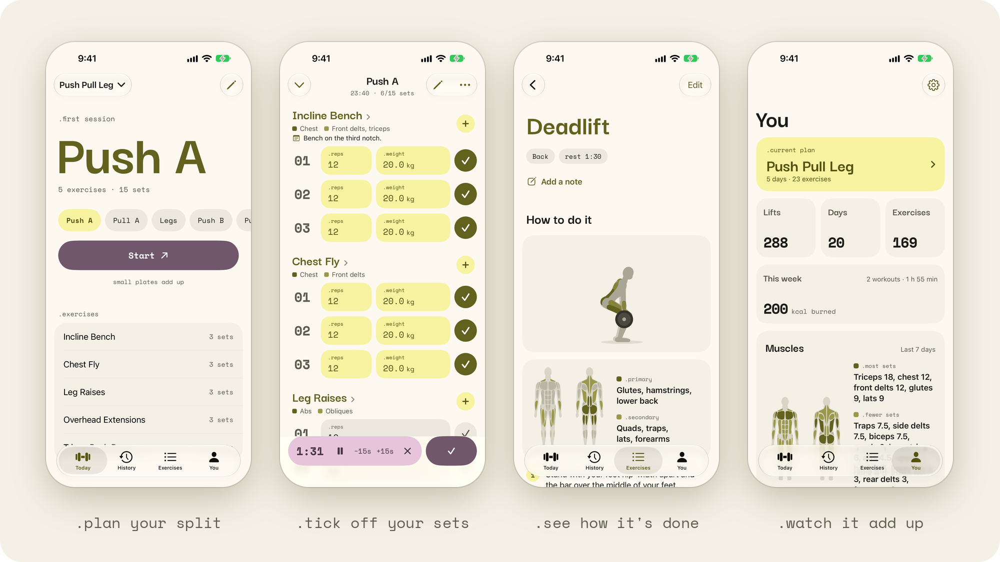

# Kamae

Kamae is a workout journal built around your training days: plan your split once, then pick a day and tick off your sets. Until November 2026 it was called Kitae; [the name](#the-name) says why it changed.

This repository has Kamae for iPhone, written in SwiftUI, in `ios/`, and Kamae for Android, written with Jetpack Compose, in `android/`. Kamae's data and rules are a Kotlin module the two share, in `shared/`, so both apps store, count and back up the same way.

**Status:** beta. Kamae for iPhone is on TestFlight, and Kamae for Android has test builds.

<picture>
  <source media="(prefers-color-scheme: dark)" srcset="docs/screenshots/readme-dark.png">
  
</picture>

More screenshots of the iPhone app, in light and dark mode, are in [docs/screenshots](docs/screenshots).

## Try it

### iPhone

Join the beta at [testflight.apple.com/join/GTKbw4Hg](https://testflight.apple.com/join/GTKbw4Hg) on an iPhone with iOS 26 or newer. The link opens Apple's TestFlight app, which installs Kamae and its updates. If you've been testing Kitae, Kamae arrives as an update and keeps your data. Send feedback from TestFlight, or report bugs and ask for features in [the issues on GitHub](https://github.com/koyomi-apps/kitae-ios/issues).

To sideload it instead, each iPhone [release on GitHub](https://github.com/koyomi-apps/kitae-ios/releases) (tagged like `v1.0-3`) has an IPA to install with AltStore, SideStore or Sideloadly, which sign it with your own Apple Account. With a free account, the app stops opening after seven days until it's refreshed, and it uses two of the account's App IDs, one for the rest timer on the Lock Screen. Sideloaded copies don't update by themselves, and they keep their data apart from the TestFlight one; move between them with a backup. What's new in each build is in the [changelog](ios/CHANGELOG.md).

### Android

Test builds of Kamae for Android, for Android 8.0 or newer, are pre-releases on [the releases page](https://github.com/koyomi-apps/kitae-ios/releases) (tagged like `android-v0.9.1`), each with an APK to install. Version 1.0.0 is planned for F-Droid as well.

Kamae for Android is a new app with an ID of its own, `ca.gureet.kamae`, rather than an update to Kitae for Android 2.0.0, so it installs beside it. To bring your plans, workouts and settings over, back up in Kitae, then restore the backup on Kamae's welcome screen. Kitae for Android 2.0.0 stays as it is, on F-Droid and at [codeberg.org/gureetk/kitae](https://codeberg.org/gureetk/kitae).

## Goals

- **Training days first:** named training days, sets planned ahead, plans that keep up with you, a rest timer, exercise pages, history and stats
- **A real app on each phone:** on iPhone, iOS's own navigation, sheets and menus, with the rest timer on the Lock Screen and in the Dynamic Island; on Android, Material 3's, with the rest timer in a notification
- **Private:** no accounts and no internet access. Your data stays on your phone
- **Backups that work across platforms:** a backup from either app restores in the other, and so do Kitae's

## The name

構え (*kamae*) is Japanese for a stance: the set, ready position you take before you move, as in kendo or karate. In the gym it's the moment before a lift, feet planted and grip set, when the work begins.

Kamae was called Kitae until November 2026, from 鍛え (*kitae*), the Japanese *kitaeru*, "to forge, to train": what lifting does to you, one session at a time. Another workout log on the App Store already went by Kitae, so the app took a name of its own rather than share one.

On iPhone only the name changed: it's the same app, and the update keeps your data. The code, the iPhone app's ID (`ca.gureet.kitae`) and this repository's name still say Kitae, and backups are still named `kitae_backup_DD_MM.zip`, so Kitae's backups and Kamae's open in either app.

## Building

**iPhone:** open `ios/Kitae.xcodeproj` in Xcode 27. Xcode builds the shared Kotlin module with Gradle in a build phase, so the Mac needs a JDK 17 or newer as well, such as Temurin 17 (`brew install --cask temurin@17`); Android Studio's works too. The first build downloads Kotlin's iOS tools, so it takes a while.

**Android:** open the repository in Android Studio, or build with Gradle, a JDK 17 and the Android SDK: `./gradlew :android:assembleDebug`.

## Credits

Kamae shares its design and backup format with Kitae for Android 2.0.0, which is a fork of [Kenko](https://codeberg.org/Iamlooker/Kenko) by LooKeR. It contains none of their code.

## License

```
Kamae (formerly Kitae)
Copyright (C) 2026 Kamae Contributors

This program is free software: you can redistribute it and/or modify
it under the terms of the GNU General Public License as published by
the Free Software Foundation, either version 3 of the License, or
(at your option) any later version.

This program is distributed in the hope that it will be useful,
but WITHOUT ANY WARRANTY; without even the implied warranty of
MERCHANTABILITY or FITNESS FOR A PARTICULAR PURPOSE.  See the
GNU General Public License for more details.

You should have received a copy of the GNU General Public License
along with this program.  If not, see <https://www.gnu.org/licenses/>.
```

### Additional permission for Apple's App Store

```
Additional permission under GNU GPL version 3 section 7

Apple's App Store and TestFlight place restrictions on the people who
install apps through them that the GPL would not otherwise allow. As an
additional permission, the copyright holders allow you to convey this
program, or a work based on it, through those services anyway, provided
that you comply with the GPL in every other respect, including making the
Corresponding Source available as section 6 requires.
```

Contributions are accepted under these same terms, including this permission.
