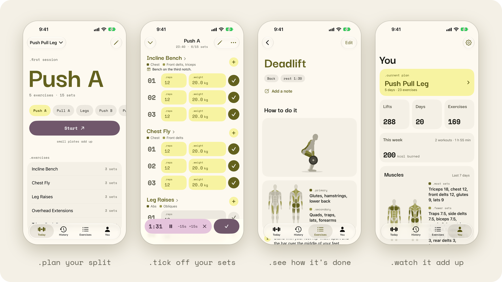

# Kitae for iPhone

Kitae is a workout journal built around your training days: plan your split once, then pick a day and tick off your sets.

This is the iPhone version, written in SwiftUI. Kitae for Android lives at [codeberg.org/gureetk/kitae](https://codeberg.org/gureetk/kitae).

**Status:** beta, on TestFlight.

<picture>
  <source media="(prefers-color-scheme: dark)" srcset="docs/screenshots/readme-dark.png">
  
</picture>

More screenshots, in light and dark mode, are in [docs/screenshots](docs/screenshots).

## Try it

Join the beta at [testflight.apple.com/join/GTKbw4Hg](https://testflight.apple.com/join/GTKbw4Hg) on an iPhone with iOS 26 or newer. The link opens Apple's TestFlight app, which installs Kitae and its updates. Send feedback from TestFlight, or report bugs and ask for features in [the issues on GitHub](https://github.com/koyomi-apps/kitae-ios/issues).

To sideload it instead, each [release on GitHub](https://github.com/koyomi-apps/kitae-ios/releases) has an IPA to install with AltStore, SideStore or Sideloadly, which sign it with your own Apple Account. With a free account, Kitae stops opening after seven days until it's refreshed, and it uses two of the account's App IDs, one for the rest timer on the Lock Screen. Sideloaded copies don't update by themselves, and they keep their data apart from the TestFlight one; move between them with a backup. What's new in each build is in the [changelog](CHANGELOG.md).

## Goals

- **Kitae's features:** named training days, sets planned ahead, plans that keep up with you, a rest timer, exercise pages, history and stats
- **A real iPhone app:** iOS's own navigation, sheets and menus, with the rest timer on the Lock Screen and in the Dynamic Island
- **Private:** no accounts and no internet access. Your data stays on your phone
- **Backups that work across platforms:** a backup from Kitae for Android restores here, and the other way round

## The name

鍛え (*kitae*) comes from the Japanese *kitaeru*, "to forge, to train": what lifting does to you, one session at a time.

## Credits

Kitae for iPhone shares its design and backup format with Kitae for Android, which is a fork of [Kenko](https://codeberg.org/Iamlooker/Kenko) by LooKeR. It contains none of their code.

## License

```
Kitae for iPhone
Copyright (C) 2026 Kitae Contributors

This program is free software: you can redistribute it and/or modify
it under the terms of the GNU General Public License as published by
the Free Software Foundation, either version 3 of the License, or
(at your option) any later version.

This program is distributed in the hope that it will be useful,
but WITHOUT ANY WARRANTY; without even the implied warranty of
MERCHANTABILITY or FITNESS FOR A PARTICULAR PURPOSE.  See the
GNU General Public License for more details.

You should have received a copy of the GNU General Public License
along with this program.  If not, see <https://www.gnu.org/licenses/>.
```

### Additional permission for Apple's App Store

```
Additional permission under GNU GPL version 3 section 7

Apple's App Store and TestFlight place restrictions on the people who
install apps through them that the GPL would not otherwise allow. As an
additional permission, the copyright holders allow you to convey this
program, or a work based on it, through those services anyway, provided
that you comply with the GPL in every other respect, including making the
Corresponding Source available as section 6 requires.
```

Contributions are accepted under these same terms, including this permission.
